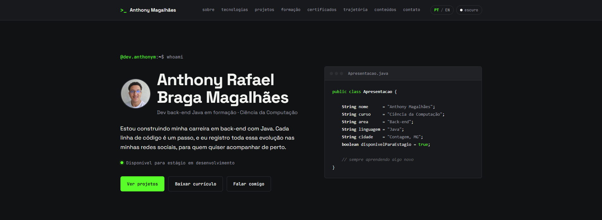

# Portfólio | Anthony Magalhães

-39FF14?style=for-the-badge&labelColor=111214)


Meu portfólio pessoal como desenvolvedor back-end Java em formação. Reúne quem eu sou, as tecnologias que uso e estudo, meus projetos, minha trajetória e formas de contato.

🔗 **Acesse:** [dev-anthonym.github.io/Portfolio](https://dev-anthonym.github.io/Portfolio)



---

## 📌 Seções

Início, Sobre mim, Tecnologias, Projetos, Formação, Certificados, Linha do tempo (contada como um histórico de commits), Conteúdos e Contato.

## ✨ Funcionalidades

- Versão em **português e inglês**, com botão de troca
- **Modo claro e escuro**
- Layout **responsivo**, para celular e computador
- Botão para **baixar o currículo** em PDF
- Estatísticas do GitHub atualizadas automaticamente

## 🤖 Sobre o desenvolvimento

Este site foi desenvolvido com **IA generativa (Claude)**. Meu foco de estudo é o **back-end com Java**: os projetos que estão no portfólio são onde está o meu aprendizado.

## 💻 Como rodar localmente

```bash
git clone https://github.com/dev-Anthonym/Portfolio.git
cd Portfolio
```

Depois é só abrir o arquivo `index.html` no navegador.

## 📫 Contato

[](https://www.linkedin.com/in/devanthony/)
[](https://github.com/dev-Anthonym)
[](mailto:dev.anthony.m@gmail.com)

---

© 2026 Anthony Rafael Braga Magalhães
